  
  

  

  

<table>
  <tr>
    <td><b>Languages</b></td>
    <td></td>
  </tr>
  <tr>
    <td><b>ML / Data</b></td>
    <td></td>
  </tr>
  <tr>
    <td><b>Web</b></td>
    <td></td>
  </tr>
  <tr>
    <td><b>Database</b></td>
    <td></td>
  </tr>
  <tr>
    <td><b>Cloud / Infra</b></td>
    <td></td>
  </tr>
  <tr>
    <td><b>OS / Device</b></td>
    <td></td>
  </tr>
  <tr>
    <td><b>Tools</b></td>
    <td></td>
  </tr>
  <tr>
    <td><b>Generative AI</b></td>
    <td></td>
  </tr>
</table>

  
  

<picture>
  <source media="(prefers-color-scheme: dark)" srcset="https://raw.githubusercontent.com/jenainex/jenainex/output/galaga-contribution-graph-dark.svg" />
  <source media="(prefers-color-scheme: light)" srcset="https://raw.githubusercontent.com/jenainex/jenainex/output/galaga-contribution-graph.svg" />
  
</picture>
